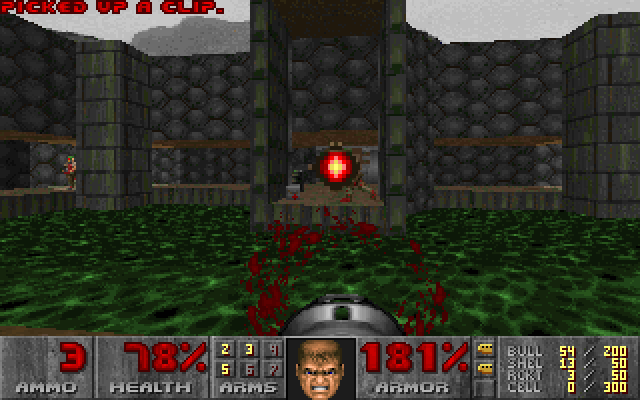

<p align="center">
  <picture>
    <source media="(prefers-color-scheme: dark)" srcset="docs/assets/logo-dark.svg">
    
  </picture>
</p>

# musql

*Pronounced "muscle." (In French)*

**SQLite-compatible SQL, accelerated by columnar storage and a JIT compiler.**

musql pairs a new storage format optimized for columnar execution with
just-in-time (JIT) compilation. The format stores columns contiguously; the JIT
turns supported query paths into native machine code at runtime. Filters and
aggregates work directly over those columns, reducing row decoding and
interpreter overhead. In a 100,000-row read benchmark, a filtered count ran
**about 300× faster than C SQLite and nearly 1,000× faster than Turso**.
See [performance](#performance) for the full comparison and measurement scope.

Use it as an embedded database through `database/sql`, import existing SQLite
data, or replicate a database across nodes that need to work independently.

- **A format built for fast queries.** The `.musq` segment format gives compiled
  code direct access to column values, with an append-only delta for writes.
- **JIT-compiled execution.** Supported query paths run as native machine code,
  with vectorized filter kernels on supported CPUs.
- **Familiar SQL.** Joins, window functions, triggers, JSON, full-text search,
  and R-tree indexes are part of the engine.
- **Vector search.** libSQL's vector functions, column types and
  `libsql_vector_idx` / `vector_top_k`, plus SQLite's `vec1` extension.
- **SQLite import and export.** Move databases between SQLite and musql's
  `.musq` format with `musql-convert`.
- **Replication over your own network.** Choose CRDT replication for independent
  writers, or leader mode with optional consensus integration.

[Get started](#get-started) · [Performance](#performance) ·
[SQLite compatibility](#sqlite-compatibility) · [Vectors](#vector-search) ·
[Replication](#replicate-a-database) ·
[How it works](#how-it-works) · [DOOM](#yes-it-runs-doom) ·
[Development](#development)

## Get started

### In a Go program

```sh
go get github.com/samyfodil/musql/driver
```

```go
import (
    "database/sql"

    _ "github.com/samyfodil/musql/driver"
)

db, err := sql.Open("sqlite", "app.musq") // created if missing
// ...then use db exactly like any database/sql database.
```

Pure Go, no CGo; needs Go 1.27 or newer. The driver registers as `sqlite`
(and `musql`), so code written for another SQLite driver usually only
changes its import. Use one SQL statement per `Exec` or `Query` call.

### As a server, no Go needed

Run `musqld` with Docker; the database lives in the `musql` volume:

```sh
docker run -p 8080:8080 -e MUSQLD_AUTH_TOKEN=secret -v musql:/data ghcr.io/samyfodil/musql
```

The image is built from the repository's [Dockerfile](Dockerfile), a 5 MB
`scratch` image; to build it yourself, run `docker build -t musql .` in the
repository root and use `musql` in place of the image name above.

Or download `musqld` for your platform from the
[latest release](https://github.com/samyfodil/musql/releases/latest) and run
`musqld -db app.musq` (the file is created if missing).

It speaks Turso's protocol, so any libSQL client connects unchanged. In
TypeScript (`npm install @libsql/client`):

```ts
import { createClient } from "@libsql/client";

const db = createClient({ url: "http://localhost:8080", authToken: "secret" });

await db.execute("CREATE TABLE IF NOT EXISTS notes (id INTEGER PRIMARY KEY, body TEXT)");
await db.execute({ sql: "INSERT INTO notes (body) VALUES (?)", args: ["hello"] });
const { rows } = await db.execute("SELECT id, body FROM notes");
console.log(rows); // [ { id: 1, body: 'hello' } ]
```

More in [Serve it to Turso and libSQL clients](#serve-it-to-turso-and-libsql-clients).

### From an existing SQLite database

The release archive also has `musql-convert`:

```sh
./musql-convert import app.db app.musq   # SQLite -> musql
./musql-convert export app.musq app.db   # musql -> SQLite
```

## Performance

**musql beats C SQLite on every workload in its benchmark.** That is 26 read
shapes and 4 single-row writes, and every read runs as JIT-compiled native code.
The benchmark fails if one stops beating C or if the JIT declines one.

Selected reads over **1,000,000 rows**, one thread each, measured on an amd64
server (Xeon D-2123IT):

| Query | musql | C SQLite | vs C SQLite | vs Turso | vs DuckDB, 1 thread |
| --- | ---: | ---: | ---: | ---: | ---: |
| `min`/`max` whole table | 25 µs | 86.2 ms | **3,400× faster** | 12,000× faster | 175× faster |
| Whole-table count | 9 µs | 5.53 ms | **610× faster** | 2,100× faster | 50× faster |
| Correlated `EXISTS` | 11.2 ms | 2.15 s | **190× faster** | 300× faster | 5.7× faster |
| `UNION ALL` compound | 875 µs | 130 ms | **150× faster** | 510× faster | 6.2× faster |
| `GROUP BY ... HAVING` | 2.61 ms | 349 ms | **134× faster** | 410× faster | 2.1× faster |
| Filtered count | 457 µs | 59.3 ms | **130× faster** | 470× faster | 7.1× faster |
| Sum over a filter | 500 µs | 63.8 ms | **128× faster** | 510× faster | 7.5× faster |
| `ORDER BY v DESC LIMIT 20` | 676 µs | 83.2 ms | **123× faster** | 1,560× faster | 8.1× faster |
| Grouped aggregate | 3.98 ms | 393 ms | **99× faster** | 330× faster | 2.0× faster |
| `LIMIT 20 OFFSET 1000` | 6.55 ms | 92.3 ms | **14× faster** | 160× faster | 1.1× faster |
| Rowid lookup | 2 µs | 11.2 µs | **5.6× faster** | 22× faster | 190× faster |
| Indexed equi-join | 12 µs | 16.6 µs | **1.4× faster** | 6.8× faster | 63× faster |

How the numbers are taken:

- C SQLite is called natively from C, with no Go in its path. Turso goes through
  its Go driver; musql through its direct engine API.
- Each workload is checked against C SQLite on up to 40 bind values, then timed
  for about 200 ms.

Scans and aggregates run as JIT-compiled code over musql's columnar format.
Point lookups and joins run as JIT-compiled VDBE programs.

Through `database/sql`, a point lookup costs about 5 µs, still 2× less than
native C SQLite.

DuckDB is an analytical engine and not SQLite-compatible. On one thread it beats
musql on 6 of the 26 shapes: TEXT sorting, `IS NULL`, a grouped count over few groups, grouped
`min`/`max`, and two subquery shapes. With its default thread count it beats
musql on more. `engine.WithWorkers(n)` lets musql split scans across goroutines
too.

Without the JIT, musql loses to C SQLite by a large multiple on scans.

Vector search is faster too: `vector_top_k` beats libSQL's index while
returning the exact top 10, and every `vec1` index beats C SQLite's. See
[Vector search](#vector-search).

[docs/benchmarks.md](docs/benchmarks.md) has:

- all 26 shapes;
- per-machine timings, including the 100k-row runs and the Apple M4;
- the multithreaded comparison with DuckDB;
- the vector benchmarks;
- the cost of calling C from Go.

Writes, through `database/sql` against C SQLite through `mattn/go-sqlite3`
([`TestBenchVsC`](compat-harness/bench_vs_c_test.go), best of 5 rounds,
amd64 Xeon D). Lower is better; under 1.0× means musql is faster:

| Write workload | musql time ÷ C SQLite time |
| --- | ---: |
| Batch `INSERT`, per row | 0.82–0.97× |
| Bulk `UPDATE ... WHERE k = ?`, per statement | 0.95–0.98× |
| Bulk `DELETE`, per statement | 0.30–0.33× |

A bulk `UPDATE` runs its loop as native code, writes rows in place, and
records each changed row as a patch of its changed columns in the delta.

The current engine uses segment storage with a writable delta. Its
[comparison harness](compat-harness/bench_columnar_vs_c_test.go) measures both
musql's direct engine and `database/sql` paths, alongside C SQLite and Turso.
For a current comparison on your machine, run from the repository root
(requires CGo):

```sh
(cd compat-harness && go test -run '^TestBenchColumnarVsC$' -count=1 -v -timeout 4h .)
```

The full suite includes expensive workloads and can take hours. For read and
write comparisons through `database/sql`, use
[`TestBenchVsC`](compat-harness/bench_vs_c_test.go):

```sh
(cd compat-harness && go test -run '^TestBenchVsC$' -count=1 -v -timeout 30m .)
```

## SQLite compatibility

musql implements SQLite's SQL dialect through its own parser, planner, and
execution engine. **SQL compatibility and file compatibility are separate:**
the engine opens musql segment files. Existing SQLite files need conversion
before you open them with the driver.

### Import and export databases

Install the converter:

```sh
go install github.com/samyfodil/musql/cmd/musql-convert@latest
```

Then convert in either direction:

```sh
# Bring an existing SQLite database into musql.
musql-convert import app.db app.musq

# Export a musql database for SQLite tools or another application.
musql-convert export app.musq exported.db
```

Open the imported database with `sql.Open("sqlite", "app.musq")`.
The [converter package](convert/sqlite/) also exposes `Import` and `Export`
for use from Go.

### What is tested

The differential harness runs SQL against both musql and C SQLite and compares
results. The whole SQL corpus mined from SQLite's own test suite (73,855
statements) runs with **zero wrong results and zero panics**. Its only declines
are 16 `PRAGMA max_page_count` statements. The rest either match C SQLite's output
exactly or are rejected by both engines. That is a measured result for the corpus,
not a claim that every SQLite behavior is identical. The
[segment-format compatibility notes](docs/segment-format-compatibility.md) list
what the format declines and why.

Storage-specific behavior differs. For example, page counts describe musql's
storage, and `PRAGMA max_page_count` is declined. Use musql's
`PRAGMA max_size = <bytes>` to cap storage per connection. The compatibility
report explains the remaining declines and how import/export is tested.

### Moving from another Go driver

Change the driver import, convert your database, and point the DSN at the
converted file. If you use `mattn/go-sqlite3` and scan `date`, `datetime`, or
`timestamp` columns into `time.Time`, enable its declared-type conversion:

```go
db, err := sql.Open("sqlite", "app.musq?_time_decltype=1&_loc=auto")
```

By default, musql returns stored values without that conversion. `_loc=auto`
uses `time.Local`; a named time zone can be supplied instead. The
[driver compatibility notes](docs/swap-readiness.md#the-one-driver-level-difference-and-the-flag-that-closes-it)
describe the conversion rules.

## Vector search

musql speaks libSQL's vector SQL: `vector()`, `vector32()` and the other
constructors, `vector_extract()`, `vector_distance_cos()` and
`vector_distance_l2()`, the `F32_BLOB(n)` family of column types, and
libSQL's index and search:

```sql
CREATE TABLE docs(id INTEGER PRIMARY KEY, emb F32_BLOB(384));
CREATE INDEX docs_emb ON docs(libsql_vector_idx(emb));
SELECT id FROM vector_top_k('docs_emb', vector(?), 10);
```

Vectors use libSQL's byte layout, and distances match libSQL's to the bit.
An index with no options searches **exactly**: it ranks every row, with JIT kernels where it can, by
its true distance, so recall is always 10/10. From 100,000 rows, or when
any of libSQL's graph options is given, it walks an approximate graph built
in the background, and searches exactly until that graph is ready.

SQLite's own vector extension, [`vec1`](https://sqlite.org/vec1), is also
built in (`CREATE VIRTUAL TABLE t USING vec1(...)`). Its tables are ordinary
tables, so a database holding one converts to and from C SQLite like any
other.

Against libSQL through its Go driver, 384-dimension float32 vectors, top 10,
one thread unless noted, on a 4-core amd64 server
([benchmarks](compat-harness/libsql/bench_test.go)):

| Workload | musql | libSQL |
| --- | ---: | ---: |
| `vector_top_k`, 100k clustered vectors | **4.1 ms, exact** | 27.5 ms, recall 10/10 |
| `vector_top_k`, 100k random vectors | **15.2 ms, exact** | 33.3 ms, recall 6/10 |
| Brute-force KNN, 100k rows, cosine | 209 ms (60 ms on 4 cores) | 264 ms |
| Brute-force KNN, 100k rows, L2 | 215 ms (61 ms on 4 cores) | 216 ms |
| Insert 2,000 vectors as text | **125–134 ms** | 173–185 ms |

libSQL's index answers from a DiskANN graph and can miss neighbours;
musql's default index returns the exact top 10 and is still faster here.

`vec1` against C SQLite with vec1 built for speed (AVX2/FMA), 100,000
clustered vectors of 384 dimensions, one thread, mean of 200 queries, on an
amd64 Xeon D ([benchmark](compat-harness/vec1/bench_test.go)):

| Index | musql query | C SQLite query | recall@10 (musql / C) | musql train + build | C train + build |
| --- | ---: | ---: | ---: | ---: | ---: |
| flat | **25.0 ms** | 72.5 ms | 1.000 / 1.000 | 0.8 s | 0.9 s |
| ivf | **8.5 ms** | 19.3 ms | 1.000 / 1.000 | 2.8 s | 3.8 s |
| ivfpq | **1.30 ms** | 1.86 ms | 0.999 / 0.999 | 12.1 s | 16.5 s |
| ivfopq | **0.99 ms** | 1.30 ms | 0.990 / 0.993 | 60.1 s | 71.5 s |
| ivfbq | **0.98 ms** | 1.33 ms | 0.994 / 0.996 | 2.7 s | 3.5 s |

Inserting the 100,000 rows takes about the same time in both (0.59–0.63 s
for musql, 0.52–0.64 s for C).

## Serve it to Turso and libSQL clients

`musqld` serves a musql database over Hrana, the protocol libSQL and Turso
clients speak, so an app built on Turso can point at musql without code changes:

```sh
go run -C hrana ./cmd/musqld -db app.musq -listen :8080 -auth-token "$TOKEN"
```

```ts
import { createClient } from "@libsql/client";
const db = createClient({ url: "http://localhost:8080", authToken: process.env.TOKEN });
await db.execute("SELECT 1");
```

`http://`, `ws://` and `libsql://` URLs all work. musqld implements Hrana 1–3
over HTTP and WebSocket, in JSON and Protobuf: pipelines, batches with
conditions, cursors, stored SQL, `describe` and interactive transactions. CI runs
Turso's own clients against it, `@libsql/client` for Node and `libsql-client-go`
([examples/turso](examples/turso/)).

To serve many databases, give musqld a directory. Like Turso, the first label of
the host name picks the database, so `http://app.example.com:8080` serves
`./dbs/app.musq`:

```sh
go run -C hrana ./cmd/musqld -dir ./dbs -create -listen :8080
```

## Replicate a database

The [replication package](replication/) returns a regular `*sql.DB` and captures
row and schema changes as transactions commit. You supply the network through
`replication.WithTransport`; the base package has no networking dependency.

Choose the mode that fits your application:

| Mode | Behavior |
| --- | --- |
| CRDT | Every node can write, including while disconnected. Conflicts resolve per column using a hybrid logical clock, and nodes converge after reconnecting. |
| Leader | Only the node selected by your `isWriter` callback can commit. Changes reach followers asynchronously. |
| Leader with quorum | Commits go through your consensus log and return after quorum commitment and local application. |

CRDT merges can violate constraints that each local write satisfied, such as
foreign keys or a multi-column `CHECK`. Replicated databases also restrict
features such as triggers, virtual tables, and `WITHOUT ROWID`. Read the
[replication guide](replication/README.md) for setup, conflict behavior, and
supported schemas, or start with the [libp2p example](examples/libp2p/).

## How it works

Columnar segments put a column's values together in memory, so a filter can
scan the values it needs without decoding every field of every row. The JIT
compiles supported execution paths to native code, with vectorized filter
kernels on supported CPUs. The planner also uses index seeks and specialized
aggregate and top-N paths to avoid unnecessary work.

The driver connects `database/sql` to the parser, planner, and execution engine.
Committed changes go into an append-only delta; compaction folds them into the
segments. SQLite file handling lives in the converter. Replication captures
changes within the same transaction as the data it tracks.

| Package | Purpose |
| --- | --- |
| [engine](engine/) | SQL parsing, planning, execution, storage, triggers, full-text search, R-tree indexes, and JSON. |
| [driver](driver/) | The `database/sql` interface, connection handling, and transaction change capture. |
| [convert/sqlite](convert/sqlite/) | Import and export between SQLite files and musql storage. |
| [replication](replication/) | Change logs, conflict resolution, synchronization, and leader/quorum integration. |
| [examples/doom](examples/doom/) | DOOM compiled to VDBE bytecode, with windowed and headless runners. |
| [examples/libp2p](examples/libp2p/) | A replication transport and end-to-end tests in a separate module. |
| [compat-harness](compat-harness/) | Differential tests against C SQLite in a separate module that requires CGo. |

## Yes, it runs DOOM

<p align="center"></p>

The same virtual machine that executes SQL can run DOOM. The
[DOOM example](examples/doom/) takes unmodified doomgeneric through
**C → LLVM IR → musql VDBE bytecode**, then executes it with `engine.ProgramStmt`.
Each frame comes back as a result row; keyboard events go in as bound parameters.

Measured **about 38 fps without JIT and 96 fps with JIT on an Intel i9**.
See the [measurement details](examples/doom/README.md#measured-performance).

The program has 159,609 instructions and 40,561 registers. The idea comes from
Turso's [DOOM example](https://github.com/tursodatabase/turso-vdbe-doom-example).

The quickest way to play downloads the latest release for your machine and
starts it (Doom's IR and the shareware WAD, about 20 MB, follow on first run).

macOS and Linux:

```sh
curl -fsSL https://raw.githubusercontent.com/samyfodil/musql/main/examples/doom/run.sh | sh
```

Windows (PowerShell):

```powershell
irm https://raw.githubusercontent.com/samyfodil/musql/main/examples/doom/run.ps1 | iex
```

Or from source, in the repository root:

```sh
cd examples/doom
go run ./cmd/doom
```

Arrows move, Ctrl fires, and Space opens doors. Use `./cmd/doomhl` instead of
`./cmd/doom` for a headless run that reports fps and saves the last frame as a
PNG. See the [example README](examples/doom/README.md) for controls and compiler tests.

## Development

From a checkout of this repository:

```sh
make test               # Test the main module and the libp2p example.
make vet                # Vet both modules.
make harness            # Compare with C SQLite (requires CGo).
make build_all_targets  # Cross-compile the supported GOOS/GOARCH matrix.
```

The full SQL corpus can be replayed with `scripts/sweep`. See the
[compatibility notes](docs/segment-format-compatibility.md) for what the format
declines and which storage numbers are excluded from SQL comparisons.


## About the name

musql is *muscle SQL*: small, and stronger than it looks, like Mash Burnedead
from *Mashle*. That is also why the logo is a cream puff, his favorite food,
with data sliced inside.
